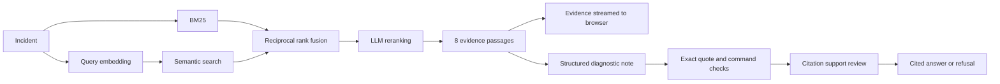

# Runbook

[](https://github.com/BhaveshY/runbook-rag/actions/workflows/ci.yml)

[](LICENSE)

Runbook answers Kubernetes troubleshooting questions from 28 pinned pages of the official documentation. Every statement in an answer quotes its source word for word. The server drops any statement whose quote it cannot find in the retrieved passage, then sends a second request that asks whether each quote supports its statement. Runbook has no cluster access and never runs commands.


## Results

The [evaluation report](eval/results/latest.json) records every question, retrieved passage, citation decision, and judge verdict from real OpenAI calls.

| Retrieval | Evidence recall@5 | Document recall@5 | MRR@5 | p95 latency |
|---|---:|---:|---:|---:|
| BM25 | 70.3% | 98.4% | 0.594 | 0.44 ms |
| Semantic | 59.4% | 100.0% | 0.547 | 514 ms |
| Hybrid (RRF) | 71.9% | 98.4% | 0.564 | 514 ms |
| **Hybrid + LLM reranking** | **87.5%** | 100.0% | **0.859** | 3,127 ms |

The benchmark has 32 answerable questions and 8 that the app should refuse, over 773 passages. Reranking lifts evidence recall by 17.2 points over BM25 (95% bootstrap interval 0.0 to 34.4 points). Recall is 100% on the development split and 75% on the holdout split.

For the 22 questions that also go through answer generation:

- 21 completed. One failed when the support review request errored, and the app withheld that answer.
- All 27 generated quotes matched the source text exactly.
- The separate judge model found 22 of 22 statements and 1 of 2 checks supported. It rejected the other check because its command added a `-n` flag that the quoted passage never shows.
- All 8 out-of-scope questions were refused.
- The full pipeline, including review, has a p95 of 7.3 seconds.

I wrote the questions and labels myself with AI help, and I saw holdout results before adding reranking, so the holdout is not blind. The judge comes from the same provider as the serving model and may share its mistakes. [The evaluation card](docs/evaluation.md) covers method and limits.

These figures come from the code at commit `4a95aef`. Later commits restructure the Python without changing retrieval output. The report records a hash of the source code, so the Evaluation screen labels the report historical until you rerun `make evaluate`.

## How it works



**Pinned sources.** `ingest` downloads 28 pages from one `kubernetes/website` commit, splits them at headings, and embeds each passage. Every passage keeps a GitHub link to its exact lines. `ingest` names the index directory after its content hash and activates it only after every checksum matches.

**Four retrieval modes.** BM25, semantic search, reciprocal rank fusion of both, and fusion followed by LLM reranking all share one corpus. Reranking orders 30 candidates. If it fails or takes longer than 12 seconds, the server falls back to fusion order and says so in the trace. No mode returns more than two passages from one page. With 773 vectors, a NumPy matrix product replaces a vector database.

**Checked answers.** The model returns JSON in a strict schema. The server then drops any statement whose quote is missing from the cited passage, and any command outside a read-only `kubectl` allowlist. A second request checks each remaining quote against its statement. If no statement survives, the user gets a refusal with follow-up questions.

**Streaming UI.** Evidence reaches the browser before the answer. Clicking a citation moves focus to the quoted passage. Export produces Markdown with every quote and link. The UI is plain HTML, CSS, and JavaScript with no build step.

[Architecture and tradeoffs](docs/architecture.md) explains each decision. The server hosts an API reference at `/docs` and the schema at `/openapi.json`.

## Run it

You need Python 3.12+, [uv](https://docs.astral.sh/uv/), and an OpenAI API key with access to the configured models. No model runs locally. Embedding, reranking, generation, and review all call OpenAI.

```bash
uv sync --frozen
read -rsp 'OpenAI API key: ' OPENAI_API_KEY && export OPENAI_API_KEY
uv run python -m runbook ingest
uv run python -m runbook serve
```

Open http://127.0.0.1:8000. The first `ingest` embeds about 170,000 tokens. Running it again with unchanged sources reuses the existing index. [.env.example](.env.example) lists every setting.

Reranking, generation, and review use `gpt-6-luna`, listed at $0.10 per million input tokens and $0.50 per million output tokens on [OpenAI's pricing page](https://developers.openai.com/api/docs/pricing) as of October 22, 2026. Query embeddings use `text-embedding-3-small`. One reranked answer makes four requests: embedding, reranking, generation, and review. The trace records token use for each.

## Test

```bash
make lint
make test
```

[tests/test_e2e.py](tests/test_e2e.py) runs the real `ingest` and `serve` commands on a three-page fixture corpus, with a small local HTTP server standing in for OpenAI. It then calls every retrieval mode and the streamed diagnosis over HTTP, and checks the auth and input limits. It needs no API key or network and finishes in about two seconds. CI also builds the wheel and the Docker image.

[Verification](docs/verification.md) records earlier manual runs against live models, Chromium, the installed wheel, and the container.

## Evaluate

```bash
uv run python -m runbook evaluate                    # retrieval only
uv run python -m runbook evaluate --answers          # plus generation and judging
uv run python -m runbook evaluate --split holdout --output eval/results/holdout.json
```

The evaluator first confirms that every gold label exists in the index, so a broken label fails before any paid request. It reports recall, MRR, nDCG, latency, bootstrap intervals, quote validity, judged support, review removals, and refusal accuracy.

## Deploy

Run `ingest` before building so the image includes the index. Pass the key at runtime.

```bash
docker build -t runbook .
docker run --rm -p 127.0.0.1:8000:8000 -e OPENAI_API_KEY runbook
```

The container runs as an unprivileged user. For a shared instance, set `RUNBOOK_ACCESS_TOKEN` and a spending limit on the OpenAI account. The rate limit (20 requests per minute per client), the daily paid-request budget, and the embedding cache live in process memory, so each replica keeps its own. The server stores no incidents, answers, or credentials, and sends `store: false` to OpenAI.

## Scope

The corpus covers Kubernetes 1.35 core documentation. Runbook cannot see your cluster, so it can explain documented behavior and suggest read-only checks, but it cannot name a root cause. Kubernetes operators, cloud-provider behavior, and other Kubernetes versions need more sources and a new evaluation.

Code is [MIT](LICENSE). Kubernetes documentation and the excerpts in this repository are [CC BY 4.0](NOTICE). This is an independent project with no Kubernetes or CNCF affiliation.
