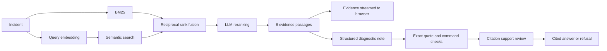

# Runbook

[](https://github.com/BhaveshY/runbook-rag/actions/workflows/ci.yml)

[](LICENSE)

Runbook answers Kubernetes troubleshooting questions from 28 pinned pages of the official documentation. Every statement in an answer quotes its source word for word. The server drops any statement whose quote it cannot find in the retrieved passage, then sends a second request that asks whether each quote supports its statement. Runbook has no cluster access and never runs commands.


## Results

The [evaluation report](eval/results/latest.json) records every question, retrieved passage, citation decision, and judge verdict from one run through the Codex CLI.

| Retrieval | Evidence recall@5 | Document recall@5 | MRR@5 | p95 latency |
|---|---:|---:|---:|---:|
| BM25 | 70.3% | 98.4% | 0.594 | 0.46 ms |
| Semantic | 57.8% | 98.4% | 0.505 | 12 ms |
| Hybrid (RRF) | 73.4% | 98.4% | 0.604 | 12 ms |
| **Hybrid + LLM reranking** | **84.4%** | 100.0% | **0.828** | 4,748 ms |

The benchmark has 32 answerable questions and 8 that the app should refuse, over 773 passages. Reranking lifts evidence recall by 14.1 points over BM25, but the 95% bootstrap interval runs from -3.1 to 31.3 points, so this set is too small to rule out no gain. Recall is 93.8% on the development split and 75.0% on the holdout split. All five misses retrieved the right page but not the labeled passage.

For the 22 questions that also go through answer generation:

- All 22 completed.
- 32 of 35 generated quotes matched the source text exactly. The quote check removed the 2 statements and 1 check that cited the other 3, and the support review removed 1 more check.
- The separate judge model found 20 of 21 kept statements and 1 of 2 kept checks supported. It rejected a statement that added a claim its quote did not make, and a check whose command added a `-n` flag the quoted passage never shows.
- All 8 out-of-scope questions were refused, and all 14 answerable ones were answered.
- The full pipeline, including review, has a p95 of 14.0 seconds. Most of that is Codex CLI start-up and its own prompt, about 19,000 input tokens per call, so the API path would be faster.

I wrote the questions and labels myself with AI help, and I saw holdout results before adding reranking, so the holdout is not blind. The judge (`gpt-5.6-sol`) comes from the same provider as the serving model (`gpt-5.6-luna`) and may share its mistakes. [The evaluation card](docs/evaluation.md) covers method, limits, and earlier runs.

## How it works



**Pinned sources.** `ingest` downloads 28 pages from one `kubernetes/website` commit, splits them at headings, and embeds each passage on the CPU with `BAAI/bge-small-en-v1.5`. Every passage keeps a GitHub link to its exact lines. `ingest` names the index directory after its content hash and activates it only after every checksum matches.

**Four retrieval modes.** BM25, semantic search, reciprocal rank fusion of both, and fusion followed by LLM reranking all share one corpus. Reranking asks a model to order 30 candidates. If it fails or takes longer than 12 seconds, the server falls back to fusion order and says so in the trace. No mode returns more than two passages from one page. With 773 vectors, a NumPy matrix product replaces a vector database.

**Checked answers.** The model returns JSON in a strict schema. Model calls go through the Codex CLI by default, so a ChatGPT plan is enough, or through the OpenAI API with a key. The server then drops any statement whose quote is missing from the cited passage, and any command outside a read-only `kubectl` allowlist. A second request checks each remaining quote against its statement. If no statement survives, the user gets a refusal with follow-up questions.

**Streaming UI.** Evidence reaches the browser before the answer. Clicking a citation moves focus to the quoted passage. Export produces Markdown with every quote and link. The UI is plain HTML, CSS, and JavaScript with no build step.

[Architecture and tradeoffs](docs/architecture.md) explains each decision. The server hosts an API reference at `/docs` and the schema at `/openapi.json`.

## Run it

You need Python 3.12+, [uv](https://docs.astral.sh/uv/), and the [Codex CLI](https://learn.chatgpt.com/docs/codex/cli) signed in with a ChatGPT plan. No API key is needed.

```bash
uv sync --frozen
codex login
uv run python -m runbook ingest
uv run python -m runbook serve
```

Open http://127.0.0.1:8000. The first `ingest` downloads the 64 MB embedding model and embeds 773 passages, which took 80 seconds on an Apple silicon Mac. Running it again with unchanged sources reuses the index. [.env.example](.env.example) lists every setting.

Each reranked answer runs `codex exec` three times (reranking, generation, and review), and those calls count against your plan's Codex usage limits. With a ChatGPT login, Codex returned `model_not_found` for `gpt-6-luna`, `gpt-6-sol`, and `gpt-6.1-sol`, so the defaults are `gpt-5.6-luna` for serving and `gpt-5.6-sol` for judging. To use the OpenAI API instead, set `RUNBOOK_BACKEND=openai`, `OPENAI_API_KEY`, and `RUNBOOK_MODEL`, `RUNBOOK_RERANK_MODEL`, and `RUNBOOK_REVIEW_MODEL` to models your key can use. The trace records token use for each call.

## Test

```bash
make lint
make test
```

[tests/test_e2e.py](tests/test_e2e.py) runs the real `ingest` and `serve` commands on a three-page fixture corpus with the real embedding model. It runs once per backend: a fake `codex` executable stands in for the Codex CLI, and a small local HTTP server stands in for the OpenAI API. Each run calls every retrieval mode and the streamed diagnosis over HTTP, and checks the auth and input limits. It needs no login or key and finishes in about five seconds once the model is cached. CI also builds the wheel and the Docker image.

[Verification](docs/verification.md) records earlier manual runs against live models, Chromium, the installed wheel, and the container.

## Evaluate

```bash
uv run python -m runbook evaluate                    # retrieval only
uv run python -m runbook evaluate --answers          # plus generation and judging
uv run python -m runbook evaluate --split holdout --output eval/results/holdout.json
```

The evaluator first confirms that every gold label exists in the index, so a broken label fails before any model call. The full run with `--answers` took eight minutes and 112 Codex calls. It reports recall, MRR, nDCG, latency, bootstrap intervals, quote validity, judged support, review removals, and refusal accuracy.

## Deploy

The image has no Codex CLI, so a container uses the OpenAI API. Run `ingest` before building so the image includes the index and the embedding model. Pass the key and API model names at runtime.

```bash
docker build -t runbook .
docker run --rm -p 127.0.0.1:8000:8000 -e RUNBOOK_BACKEND=openai -e OPENAI_API_KEY \
  -e RUNBOOK_MODEL -e RUNBOOK_RERANK_MODEL -e RUNBOOK_REVIEW_MODEL runbook
```

The container runs as an unprivileged user. For a shared instance, set `RUNBOOK_ACCESS_TOKEN` and a spending limit on the OpenAI account. The rate limit (20 requests per minute per client), the daily paid-request budget, and the embedding cache live in process memory, so each replica keeps its own. The server stores no incidents, answers, or credentials. With the API backend it sends `store: false` to OpenAI.

## Scope

The corpus covers Kubernetes 1.35 core documentation. Runbook cannot see your cluster, so it can explain documented behavior and suggest read-only checks, but it cannot name a root cause. Kubernetes operators, cloud-provider behavior, and other Kubernetes versions need more sources and a new evaluation.

Code is [MIT](LICENSE). Kubernetes documentation and the excerpts in this repository are [CC BY 4.0](NOTICE). This is an independent project with no Kubernetes or CNCF affiliation.
