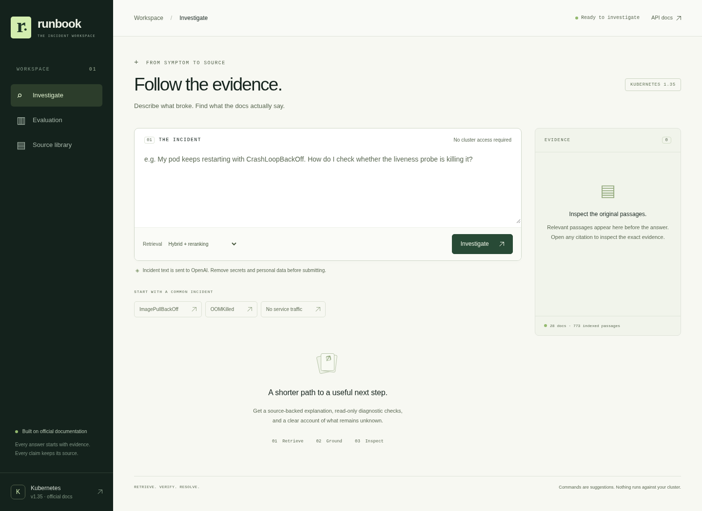
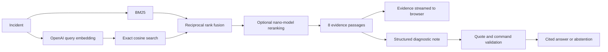

# Runbook

**Kubernetes troubleshooting with inspectable evidence and a reproducible RAG evaluation.**

Paste an incident such as `ImagePullBackOff`, an empty Service endpoint list, or a stale ConfigMap. Runbook retrieves versioned official documentation, writes a concise diagnostic note, and attaches an exact source passage to each retained claim. It suggests read-only checks and asks for missing context. You can inspect citations, compare retrieval strategies, and export the note as Markdown.



## Measured results

The committed [full report](eval/results/latest.json) contains every query, retrieval result, failure, model judgment, configuration, and timing. These are measurements from an actual run against OpenAI, not target numbers.

| Strategy | Evidence recall@5 | Document recall@5 | MRR@5 | Retrieval p95 |
|---|---:|---:|---:|---:|
| BM25 | 70.3% | 98.4% | 0.594 | 0.47 ms |
| Semantic | 59.4% | 100% | 0.547 | 410 ms |
| Hybrid / RRF | 71.9% | 98.4% | 0.564 | 410 ms |
| **Hybrid + reranking** | **87.5%** | **100%** | **0.781** | **1,713 ms** |

32 answerable questions, 8 abstention cases, 28 official documents, 773 passages. Reranked recall's 95% bootstrap interval is **75.0–96.9%**. The paired recall improvement over BM25 is **17.2 percentage points**, with a wide 95% interval of **0–34.4 points**. The fixed holdout partition scores **75.0%** evidence recall; development scores **100%**.

On the 22 cases selected for answer evaluation:

- **22/22** requests completed and made the expected answer/abstention decision, including **8/8** unsupported cases.
- **79/81** generated citations passed exact-quote validation before filtering.
- A separate `gpt-5.5` judge marked **35/36** retained claims as supported by their cited evidence.
- **6.49 s** p95 for the full answer pipeline; no answer-result cache.

This is a small, author-curated benchmark created with AI assistance. The holdout is **not blind**: initial results were inspected before adding reranking. Treat the scores as exploratory engineering evidence, not an independent SOTA claim. Citation matching establishes provenance; it does not prove semantic support. The remaining unsupported claim and all retrieval misses stay in the report. [Methodology and limitations →](docs/evaluation.md)

## Run it

Requires Python 3.12+, [uv](https://docs.astral.sh/uv/), and an OpenAI project with access to the configured models. All embeddings and language models run through OpenAI; no local model downloads are needed.

From the project directory:

```bash
uv sync --frozen

# Bash: enter the key without displaying it or saving it in shell history.
read -rsp 'OpenAI API key: ' OPENAI_API_KEY
export OPENAI_API_KEY

uv run python -m runbook ingest
uv run python -m runbook serve
```

Open **http://127.0.0.1:8000**. Ingestion downloads documentation at the exact upstream commit in [data/sources.json](data/sources.json), embeds it, and writes an immutable index. The initial index used 170,331 embedding tokens. Re-running ingestion with unchanged inputs reuses it without another embedding call.

The [environment example](.env.example) documents configuration. If you use an ignored `.env`, load it explicitly with `uv run --env-file .env python -m runbook serve`. Keys are server-side only. The browser never needs the OpenAI key.

## How it works



- **Heading-aware chunks with provenance.** Every passage retains its document, section, version, raw-source checksum, and immutable GitHub line link. Corpus files are checked against their SHA-256 hashes at startup.
- **Four inspectable retrieval modes.** BM25 preserves error identifiers; semantic retrieval handles paraphrases; RRF merges their rankings. The default reranker orders 30 candidates using `gpt-5.4-nano`. A two-passages-per-document cap limits redundancy in the final context.
- **Explicit latency tradeoff.** Select “Hybrid · faster search” to omit reranking. A 12-second reranker deadline falls back to hybrid ordering and records the degradation in the response trace and UI.
- **Evidence before prose.** Server-sent events deliver retrieved passages while `gpt-5.4-mini` prepares the answer. The note is released after citation validation, rather than token-streaming unchecked claims.
- **Constrained output.** Strict JSON schemas, unknown-source rejection, exact-quote matching, an allowlist for displayed `kubectl` commands, and abstention when the answer has no valid claims. Commands are never executed by Runbook.
- **Small operational footprint.** FastAPI, NumPy, HTTPX, and a buildless browser UI. For 773 vectors, an in-memory exact search is simpler and smaller than operating a vector database. The float32 vector matrix is approximately 2.3 MiB.

See [architecture and tradeoffs](docs/architecture.md). The self-hosted API reference is at `/docs`; the OpenAPI schema is at `/openapi.json`.

## Reproduce the evaluation

```bash
# Retrieval ablations, including model-based reranking
uv run python -m runbook evaluate

# Also generate answers and judge their cited support (additional API usage)
uv run python -m runbook evaluate --answers

# A reporting partition or a separate output file
uv run python -m runbook evaluate --split holdout --output eval/results/holdout.json
```

The evaluator validates gold labels against the indexed source text before making paid calls. It measures passage recall, document recall, MRR, nDCG, cold-query latency, bootstrap intervals, exact quotation, model-judged support, and abstention. Semantic, hybrid, and reranked retrieval share each query embedding and are each charged its measured latency; the cache cannot make one baseline look faster.

`eval/results/latest.json` powers the Evaluation screen. [The original run](eval/results/initial-hybrid.json) and [development reranking experiment](eval/results/rerank-dev-experiment.json) are preserved. No labels were revised to turn observed retrieval misses into hits.

## End-to-end verification

Verification uses the running service and Chromium, with real OpenAI calls. **No unit or integration test files or test framework are included.** The evaluation runner is the project's measurement tool.

Verified flows include live diagnosis, evidence arriving before the answer, citation inspection, clipboard copy, Markdown export, all four evaluation modes, the holdout filter, source browsing, unsupported questions, cancellation, mobile layout, request validation, token enforcement, body-size limits, rate limits, request budgets, and provider outages. Recorded outcomes: [HTTP](docs/http-verification.json), [browser](docs/browser-verification.json), and [verification notes](docs/verification.md).

## Container

Build **after ingestion** so the generated index is included. Credentials are supplied at runtime and excluded from the image context.

```bash
docker build -t runbook .
docker run --rm -p 8000:8000 -e OPENAI_API_KEY runbook
```

The process runs as a non-root user. For a shared instance, configure `RUNBOOK_ACCESS_TOKEN` and an account-level OpenAI spending limit. The built-in 20-requests/minute peer limit, daily paid-request budget, and 256-entry query-embedding cache are per process. Multiple workers require shared quotas. The app does not persist incident text; requests sent to OpenAI remain subject to that provider's retention policies even with `store: false`.

## Scope

The corpus covers **Kubernetes 1.35** core documentation at a pinned revision. Runbook has no access to your cluster and cannot establish its actual root cause. Third-party operators, cloud-specific behavior, and later releases require additional reviewed sources. Hugo presentation includes and linked external examples are not expanded during ingestion.

Source code: [MIT](LICENSE). Indexed Kubernetes documentation and attributed excerpts: [CC BY 4.0](NOTICE). Independent project; no Kubernetes/CNCF affiliation.
