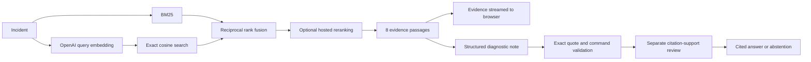

# Runbook

Kubernetes troubleshooting with cited evidence and a reproducible RAG evaluation.

Describe an incident. Runbook retrieves pinned official documentation, produces a concise explanation, and suggests diagnostic commands only when their citations survive validation and a separate support review. It has no cluster access and never executes commands.


## Measured results

The [current report](eval/results/latest.json) contains every question, retrieved source, failure, citation decision, and model verdict. These are measurements from real OpenAI calls on the current Python implementation.

| Strategy | Evidence recall@5 | Document recall@5 | MRR@5 | Retrieval p95 |
|---|---:|---:|---:|---:|
| BM25 | 70.3% | 98.4% | 0.594 | 0.44 ms |
| Semantic | 59.4% | 100.0% | 0.547 | 514 ms |
| Hybrid / RRF | 71.9% | 98.4% | 0.564 | 514 ms |
| **Hybrid + reranking** | 87.5% | 100.0% | 0.859 | 3,127 ms |

32 answerable questions, 8 abstention cases, 28 official documents, 773 passages. Reranked recall's 95% bootstrap interval is **75.0%–96.9%**. The paired recall uplift over BM25 is **17.2 percentage points**, with a 95% interval of **0.0–34.4 points**. Development recall is **100.0%**; the fixed holdout scores **75.0%**.

On the 22 answer-evaluation cases:

- **21/22** completed; answer/abstention agreement was **95.5%**, including all 8 unsupported cases.
- **27/27** generated citations matched exact source text before filtering.
- A separate evaluation request judged **22/22** retained claims and **1/2** diagnostic checks supported by their cited passages. One support-review request failed; its answer was withheld. The rejected check added a namespace flag that its quote did not document.
- Production support review removed **0 observations and 0 checks** after quote/command validation.
- Full answer-pipeline p95 was **7.33 seconds**, including review, without an answer cache.

This is a small, author-curated dataset made with AI assistance. The holdout is **not blind**. Production review uses `gpt-6-luna`; evaluation uses a separate `gpt-6.1-sol` judge. Models from the same provider can share errors; the scores are not independent expert adjudication or an industry SOTA claim. All remaining misses stay visible. [Methodology and limitations →](docs/evaluation.md)

## Run it

Requires Python 3.12+, [uv](https://docs.astral.sh/uv/), and access to the configured OpenAI models. Embeddings and language models run remotely; there are no local model downloads.

From the project directory:

```bash
uv sync --frozen

# Bash: read the key without displaying it or saving it in shell history.
read -rsp 'OpenAI API key: ' OPENAI_API_KEY
export OPENAI_API_KEY

uv run python -m runbook ingest
uv run python -m runbook serve
```

Open **http://127.0.0.1:8000**. Ingestion downloads the exact documentation revision in [data/sources.json](data/sources.json), embeds it, and atomically activates a checksummed index. The initial corpus used 170,331 embedding tokens. Re-running unchanged ingestion validates and reuses the generation.

[.env.example](.env.example) documents configuration. To load an ignored `.env` explicitly: `uv run --env-file .env python -m runbook serve`. Credentials remain server-side. `RUNBOOK_DATA_DIR` and `RUNBOOK_EVAL_REPORT` override corpus and report locations. A built Python wheel includes the UI and source/evaluation definitions; when installed outside a checkout, mutable data defaults to the current working directory.

## How it works



- **Traceable evidence.** Heading-aware passages retain document, section, version, raw-source checksum, and immutable GitHub line links. Startup and cache reuse validate index integrity.
- **Inspectable retrieval.** BM25, semantic search, hybrid RRF, and hybrid with `gpt-6-luna` reranking share one corpus. The reranker considers 30 candidates; final context is capped at two passages per document. Duplicate rankings are repaired when possible; failures visibly fall back to hybrid.
- **Reviewed answers.** `gpt-6-luna` generates a strict schema. Exact quote matching and a conservative command allowlist precede a separate `gpt-6-luna` support review. Unsupported items are removed; failed review returns an error. These checks reduce risk without proving correctness.
- **Useful interaction.** Evidence arrives before the note. Citation inspection shows all attached quotations and moves keyboard focus to the source. Export includes exact quoted excerpts and immutable links. Cancellation preserves retrieved evidence.
- **Small footprint.** FastAPI, HTTPX, NumPy, and a buildless UI. The 773-vector matrix is approximately 2.3 MiB; an exact in-memory search avoids a separate vector database.

[Architecture and tradeoffs](docs/architecture.md) explain the boundaries. `/docs` hosts the API reference; `/openapi.json` exposes the schema.

## Model cost

All serving language-model calls use `gpt-6-luna`. The [published standard price](https://developers.openai.com/api/docs/pricing), checked October 22, 2026, is **$0.10 input / $0.50 output per million tokens**. An uncached reranked answer can use four API requests: one embedding, reranking, generation, and support review. Actual cost depends on passage length and output size; model age alone does not determine value. `gpt-6.1-sol` is used only for separate answer evaluation, at its own higher price. Traces record token usage per stage.

## Reproduce the evaluation

```bash
uv run python -m runbook evaluate
uv run python -m runbook evaluate --answers
uv run python -m runbook evaluate --split holdout --output eval/results/holdout.json
```

The first command measures retrieval, including paid reranking. `--answers` also generates answers, reviews support, and makes separate evaluation-judge calls. Labels are validated against the indexed text before paid requests. The evaluator records passage/document recall, MRR, nDCG, cold-query latency, bootstrap intervals, quote validity, claim/check support, review removals, and abstention.

The Evaluation screen labels a report as historical whenever its code, dataset, corpus, or model configuration differs from the running instance. It refreshes on navigation. Earlier experiments remain in Git history; the working tree keeps the current report.

## End-to-end verification

Verification exercises running services, Chromium, an installed wheel, and a non-root container. Live-model checks are distinguished from controlled external-provider faults and replayed browser responses. **No unit or integration test suite, test framework, or test files were added to the repository.** Temporary E2E drivers remain outside it.

[Verification records](docs/verification.md) cover navigation/history, four retrieval modes, citation inspection, clipboard/export, cancellation, mobile layouts, accessible controls, malformed upstream responses, retries, review failures and deadlines, quotas, bearer authentication, chunked/slow bodies, corrupt index reuse, concurrency, and package installation. Automated accessibility scans supplement keyboard/browser checks; they are not a complete accessibility audit.

## Container and operations

Build after ingestion to include the generated index. Supply credentials at runtime:

```bash
docker build -t runbook .
docker run --rm -p 127.0.0.1:8000:8000 -e OPENAI_API_KEY runbook
```

The container runs as an unprivileged user. For a shared deployment, configure `RUNBOOK_ACCESS_TOKEN` and an account-level OpenAI spending limit. The 20-request/minute socket-peer limit, daily paid-request budget, and 256-entry embedding cache are per process; replicas need shared quotas. Serving requests do not persist credentials, incident history, or responses. OpenAI requests use `store: false`; provider retention policies still apply.

## Scope

The corpus covers **Kubernetes 1.35** core documentation at a pinned revision. It cannot observe a cluster or establish its root cause. Third-party operators, cloud-specific behavior, and newer versions require additional reviewed sources. Hugo presentation includes and linked external examples are not expanded.

Code: [MIT](LICENSE). Kubernetes documentation and attributed excerpts: [CC BY 4.0](NOTICE). Independent project; no Kubernetes/CNCF affiliation.
